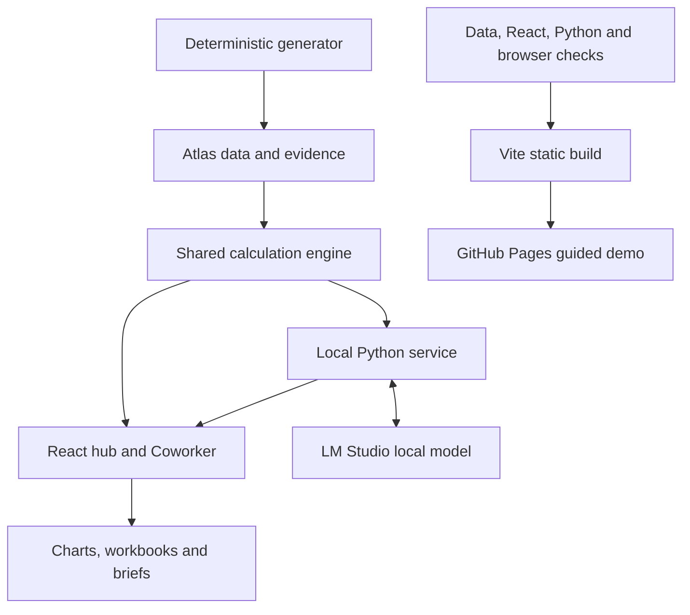

# Atlas Business Intelligence Hub
**Version:** 1.2.2 · Last updated 25 October 2026

**Portfolio owner:** [Ivan Morales · Infanatoca17](https://github.com/Infanatoca17)

**Demo:** [infanatoca17.github.io/business-intelligence-hub](https://infanatoca17.github.io/business-intelligence-hub/)

> This is a demo with dummy data. It does not contain or reproduce copyrighted, confidential or protected code, systems, or datasets.

## Why does this product exist?

Business data is often scattered across various systems and reports, each using different definitions and methodologies. This makes it difficult for organizations to align daily operations with overarching business priorities and identify issues requiring leadership's attention.

To solve this, I created *Atlas*, an integrated hub that unifies insights across portfolio delivery, staffing, budgets, and risks. *Atlas* provides decisionmakers with a comprehensive view of an organization's data, enabling them to act informed, avoid firefighting, and achieve strategic success.

Atlas integrates *Coworker*, an AI Agent that answers your questions, drafts deliverables and creates financial scenarios. For this demo, *Coworker* uses verified calculations and templates. However, *Coworker* is enabled to run any local AI model (see [Run Coworker with local AI (LM Studio)](#run-coworker-with-local-ai-lm-studio)).

## Begin here!!!

Explore *Atlas* with this 90s walkthrough:

[](https://www.youtube.com/watch?v=oXHX2xGsrbo)

Or go to the demo and explore *Atlas* on your own:
1. Start on Overview and select a Program filter.
2. Select **Review delivery** to inspect projects behind schedule.
3. Open a project from a table or chart to explore Project 360.
4. Review its deliverables, response plan, people, and financials.
5. Open **Coworker**, select **Draft the quarterly brief**, then press **Ask Coworker** to generate a response.
6. Export a filtered workbook or download any chart as PNG.

## What is included in this Hub?

| View | Working interactions |
|---|---|
| Overview | Portfolio KPIs, exposure/progress chart, globe, multiselect scope filters and delivery attention summary |
| Projects | Total projects, schedule filter in the filter bar, progress tracker, budget by delivery status and Project 360 |
| Deliverables | Active/Closed filter in the filter bar, program pie chart, quarterly cutoff ribbon and matching register/export |
| Staff | Atlas Staff, weekly hours and Active Teams KPIs; staff-count pie by program and office hours chart |
| Financials | FY Total Budget, expenditure, forecast, burn rate; budget pie by program and financial register |
| Funding Pipeline | Multiselect opportunity stage in the filter bar; requested amount, opportunities, secured amount and program pie |
| Risks | Register-only view with an Active/Closed status pie, severity/category/impact filters, probability and gross financial impact |
| Coworker | Compact fact cards and prompt area, with examples visible in the first desktop viewport; editable example question; responses only after Ask Coworker; guided, local AI and fallback modes visibly distinguished |
| Project 360 | Profile, deliverables, response plan, risks/issues, staffing, financials, funding and copyable URL |
| Search / help | Cross-portfolio search and methodology/data help |

## Data and methodology

- 48 projects (40 Active, 8 Closed; two closed examples per program), 288 deliverables, and 48 response plans.
- 96 risks and 48 issues, with dummy probability, USD loss and delay assumptions.
- 96 unique fictional staff members and 48 financial records.
- 24 funding opportunities and 24 fictional demonstration sites.
- 576 monthly observations: 12 per project, October 2025–September 2026.
- 6 dummy methodology/evidence documents, plus inspectable project and reporting records.

See [METHODOLOGY.md](docs/METHODOLOGY.md), [DATA_DICTIONARY.md](docs/DATA_DICTIONARY.md), and [RELEASE_NOTES.md](docs/RELEASE_NOTES.md).

## Run Coworker with local AI (LM Studio)

The public [Coworker demo](https://infanatoca17.github.io/business-intelligence-hub/?view=coworker) uses pre-loaded settings and guided calculations. Real local generation uses the Python-served app on **8765** and LM Studio on **1234**, on the same computer.

1. Open LM Studio, load **Qwen2.5-7B-Instruct-GGUF (Q4_K_M)** or your existing instruction model, and start the API server in **Developer**. See [LM Studio's local server guide](https://lmstudio.ai/docs/developer/core/server).
2. Open PowerShell in this repository. List the server models and copy the exact instruction-model ID:

   ```powershell
   $models = Invoke-RestMethod -Uri "http://127.0.0.1:1234/v1/models"
   $models.data | Select-Object id
   ```

3. Set the following variables in that same terminal. Replace the model ID if your listing differs:

   ```powershell
   $env:LM_STUDIO_MODEL = "qwen2.5-7b-instruct"
   $env:LM_STUDIO_BASE_URL = "http://127.0.0.1:1234/v1"
   $env:LM_STUDIO_TIMEOUT = "120"
   npm.cmd ci
   npm.cmd run build
   python -m atlas_coworker check
   python -m atlas_coworker evaluate --question "Draft the quarterly brief"
   ```

   `check` should show `reachable: true` and `model_available: true`. The evaluation must show `mode: local_ai`; a model listing or guided fallback does not verify inference. Python uses its standard library; no Python packages are required.
4. Start Atlas and keep both applications running:

   ```powershell
   python -m atlas_coworker serve --port 8765
   ```

5. Open [local Coworker](http://127.0.0.1:8765/business-intelligence-hub/?view=coworker), click **Check connection**, enable **Use local AI**, and press **Ask Coworker**. Confirm **Local AI · LM Studio** and compare the narrative with verified figures.

If your server requires authentication, use `LM_STUDIO_API_KEY` in the Python terminal and an Authorization header when listing models. Keep tokens and model weights out of Git. See [the detailed setup and troubleshooting guide](docs/LM_STUDIO_SETUP.md).

## Architecture



The public application loads its data, geography, styling and logo from compiled assets. It has no operational data connectors, remote fonts, analytics, external images or sign-in. It makes a same-origin capability request to detect the optional local service; on Pages, local AI is unavailable and guided mode remains usable. The GitHub profile link opens only when selected by a visitor.

For local inference, the Python service serves the built frontend and API from localhost. It calls LM Studio's localhost endpoint and keeps optional LM Studio authentication in the server environment. The model can draft text; it cannot replace calculated figures, repair records, send messages or approve reports.

## Dependencies, attribution and licensing

Exact frontend dependency versions are recorded in `package-lock.json`. Model weights are not included. Public geographic data and third-party software notices are in [THIRD_PARTY_NOTICES.md](THIRD_PARTY_NOTICES.md); model licensing belongs to the selected model's source.

This product's concept, direction and implementation belong to Ivan Morales.
